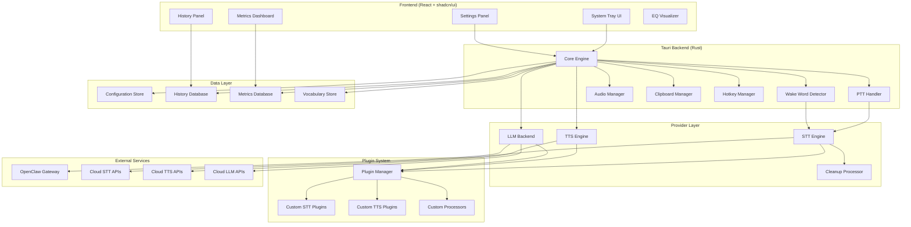
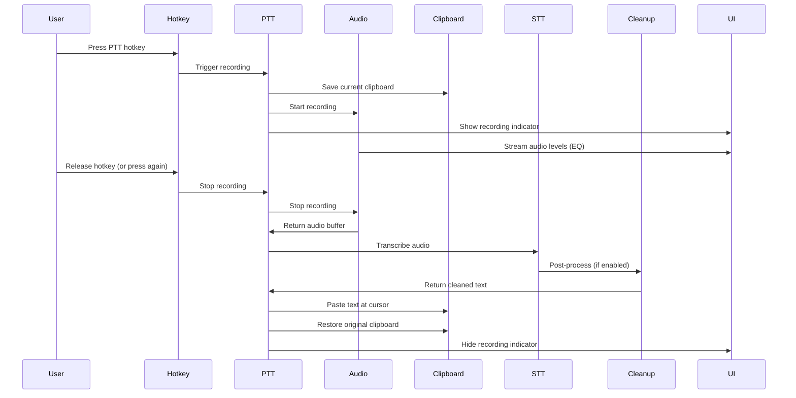
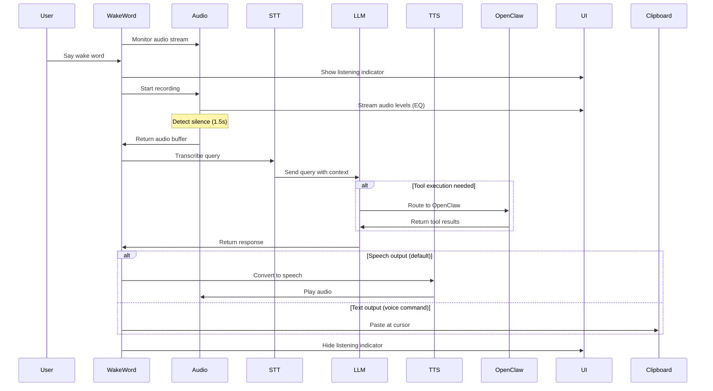

# Design Document: Windows Voice Assistant

## Overview

The Windows Voice Assistant is a cross-platform, dual-mode voice application built on Tauri (Rust backend) with a React + shadcn/ui frontend. It provides both explicit speech-to-text transcription (PTT mode) and conversational AI assistant capabilities (wake word mode). The architecture emphasizes modularity, extensibility through plugins, and efficient resource management for systems with limited GPU memory (4GB VRAM on Intel Arc A370M).

### Key Design Principles

1. **Modularity**: Provider-agnostic interfaces for STT/TTS/LLM with hot-swappable implementations
2. **Performance**: GPU-accelerated local processing with intelligent memory management
3. **Resilience**: Graceful degradation, automatic fallbacks, offline capability
4. **Extensibility**: Plugin architecture for custom providers and processors
5. **Privacy**: Local-first processing with explicit user control over cloud usage
6. **Cross-Platform**: Platform abstraction layer for Windows/macOS/Linux support

## Architecture

### High-Level Architecture



### Component Interaction Flow

**Push-to-Talk Flow:**


**Wake Word Flow:**


## Components and Interfaces

### 1. Core Engine

**Responsibilities:**
- Application lifecycle management
- Component coordination
- Event routing
- State management
- Error handling and recovery

**Interface:**
```rust
pub trait CoreEngine {
    fn initialize() -> Result<Self, Error>;
    fn start(&mut self) -> Result<(), Error>;
    fn stop(&mut self) -> Result<(), Error>;
    fn handle_event(&mut self, event: Event) -> Result<(), Error>;
    fn get_state(&self) -> ApplicationState;
}

pub enum Event {
    HotkeyPressed(HotkeyId),
    WakeWordDetected,
    AudioDeviceChanged(DeviceId),
    NetworkStatusChanged(NetworkStatus),
    ProviderError(ProviderId, Error),
    // ... other events
}

pub struct ApplicationState {
    pub is_recording: bool,
    pub active_mode: Mode,
    pub current_provider: ProviderConfig,
    pub network_status: NetworkStatus,
    pub gpu_memory_usage: f32,
}
```

### 2. STT Engine

**Responsibilities:**
- Manage multiple STT providers
- Provider selection and fallback
- Audio preprocessing
- Streaming transcription support
- Confidence score handling

**Interface:**
```rust
pub trait STTProvider {
    fn name(&self) -> &str;
    fn initialize(&mut self, config: &STTConfig) -> Result<(), Error>;
    fn transcribe(&self, audio: &AudioBuffer) -> Result<Transcription, Error>;
    fn transcribe_streaming(&self, audio_stream: AudioStream) -> Result<TranscriptionStream, Error>;
    fn supports_language(&self, lang: Language) -> bool;
    fn supports_streaming(&self) -> bool;
    fn is_local(&self) -> bool;
}

pub struct Transcription {
    pub text: String,
    pub confidence: Option<f32>,
    pub alternatives: Vec<Alternative>,
    pub language: Language,
    pub duration_ms: u64,
}

pub struct STTEngine {
    providers: HashMap<String, Box<dyn STTProvider>>,
    active_provider: String,
    fallback_chain: Vec<String>,
}

impl STTEngine {
    pub fn register_provider(&mut self, provider: Box<dyn STTProvider>);
    pub fn set_active_provider(&mut self, name: &str) -> Result<(), Error>;
    pub fn transcribe_with_fallback(&self, audio: &AudioBuffer) -> Result<Transcription, Error>;
}
```

**Provider Implementations:**

- **WhisperCppProvider**: SYCL-accelerated Whisper.cpp for Intel Arc
- **ParakeetProvider**: NVIDIA/MLX-optimized Parakeet v2
- **VoskProvider**: Lightweight offline Vosk
- **CoquiSTTProvider**: Mozilla DeepSpeech successor
- **AssemblyAIProvider**: Cloud-based AssemblyAI
- **DeepgramProvider**: Fast streaming cloud STT
- **AzureSpeechProvider**: Azure Speech Services
- **GoogleCloudSTTProvider**: Google Cloud Speech-to-Text
- **RevAIProvider**: Rev.ai cloud STT
- **OpenAIWhisperProvider**: OpenAI Whisper API

### 3. TTS Engine

**Responsibilities:**
- Manage multiple TTS providers
- Provider selection
- Audio playback
- Voice selection
- Latency optimization

**Interface:**
```rust
pub trait TTSProvider {
    fn name(&self) -> &str;
    fn initialize(&mut self, config: &TTSConfig) -> Result<(), Error>;
    fn synthesize(&self, text: &str) -> Result<AudioBuffer, Error>;
    fn synthesize_streaming(&self, text: &str) -> Result<AudioStream, Error>;
    fn list_voices(&self) -> Vec<Voice>;
    fn supports_streaming(&self) -> bool;
    fn is_local(&self) -> bool;
}

pub struct TTSEngine {
    providers: HashMap<String, Box<dyn TTSProvider>>,
    active_provider: String,
    audio_player: AudioPlayer,
}

impl TTSEngine {
    pub fn register_provider(&mut self, provider: Box<dyn TTSProvider>);
    pub fn speak(&self, text: &str) -> Result<(), Error>;
    pub fn stop_speaking(&self);
}
```

**Provider Implementations:**

- **PiperTTSProvider**: Fast neural local TTS
- **CoquiTTSProvider**: High-quality local TTS with voice cloning
- **SherpaONNXProvider**: Cross-platform ONNX-based TTS
- **InworldTTSProvider**: Inworld AI TTS-1.5 (low latency)
- **ElevenLabsProvider**: Ultra-realistic cloud TTS
- **AzureSpeechProvider**: Azure Speech Services TTS
- **GoogleCloudTTSProvider**: Google Cloud Text-to-Speech
- **AmazonPollyProvider**: Amazon Polly neural voices
- **PlayHTProvider**: Play.ht cloud TTS
- **OpenAITTSProvider**: OpenAI TTS

### 4. LLM Backend

**Responsibilities:**
- Manage LLM providers
- Conversation context management
- OpenClaw integration
- Tool execution routing
- Response streaming

**Interface:**
```rust
pub trait LLMProvider {
    fn name(&self) -> &str;
    fn initialize(&mut self, config: &LLMConfig) -> Result<(), Error>;
    fn generate(&self, prompt: &str, context: &ConversationContext) -> Result<String, Error>;
    fn generate_streaming(&self, prompt: &str, context: &ConversationContext) -> Result<ResponseStream, Error>;
    fn supports_tools(&self) -> bool;
}

pub struct LLMBackend {
    providers: HashMap<String, Box<dyn LLMProvider>>,
    active_provider: String,
    openclaw_client: Option<OpenClawClient>,
    context_manager: ContextManager,
}

pub struct ConversationContext {
    pub session_id: String,
    pub messages: Vec<Message>,
    pub created_at: DateTime<Utc>,
    pub last_activity: DateTime<Utc>,
}

impl LLMBackend {
    pub fn query(&mut self, text: &str) -> Result<String, Error>;
    pub fn query_with_tools(&mut self, text: &str) -> Result<String, Error>;
    pub fn clear_context(&mut self, session_id: &str);
}
```

**Provider Implementations:**

- **GeminiProvider**: Google Gemini models (preferred)
- **OpenRouterProvider**: OpenRouter multi-model access
- **OpenAIProvider**: OpenAI GPT models
- **ClaudeProvider**: Anthropic Claude via OpenRouter

### 5. Audio Manager

**Responsibilities:**
- Audio device enumeration and selection
- Audio capture and playback
- Audio preprocessing (noise suppression, AGC)
- Device hot-swapping
- Audio level monitoring

**Interface:**
```rust
pub struct AudioManager {
    input_device: Option<AudioDevice>,
    output_device: Option<AudioDevice>,
    recorder: AudioRecorder,
    player: AudioPlayer,
    preprocessor: AudioPreprocessor,
}

pub struct AudioDevice {
    pub id: String,
    pub name: String,
    pub device_type: DeviceType,
    pub sample_rate: u32,
    pub channels: u16,
}

impl AudioManager {
    pub fn list_input_devices(&self) -> Vec<AudioDevice>;
    pub fn list_output_devices(&self) -> Vec<AudioDevice>;
    pub fn set_input_device(&mut self, device_id: &str) -> Result<(), Error>;
    pub fn start_recording(&mut self) -> Result<AudioStream, Error>;
    pub fn stop_recording(&mut self) -> Result<AudioBuffer, Error>;
    pub fn play_audio(&self, audio: &AudioBuffer) -> Result<(), Error>;
    pub fn get_audio_levels(&self) -> AudioLevels;
}

pub struct AudioPreprocessor {
    pub noise_suppression: bool,
    pub auto_gain_control: bool,
    pub silence_threshold: f32,
}
```

### 6. PTT Handler

**Responsibilities:**
- Hotkey monitoring
- Recording lifecycle management
- Clipboard preservation
- Text pasting
- Mode switching (press-hold vs toggle)

**Interface:**
```rust
pub struct PTTHandler {
    mode: PTTMode,
    is_recording: bool,
    audio_manager: Arc<Mutex<AudioManager>>,
    clipboard_manager: Arc<Mutex<ClipboardManager>>,
    stt_engine: Arc<STTEngine>,
    cleanup_processor: Option<Arc<CleanupProcessor>>,
}

pub enum PTTMode {
    PressHoldRelease,
    PressStartStop,
}

impl PTTHandler {
    pub fn on_hotkey_press(&mut self) -> Result<(), Error>;
    pub fn on_hotkey_release(&mut self) -> Result<(), Error>;
    pub fn set_mode(&mut self, mode: PTTMode);
}
```

### 7. Wake Word Detector

**Responsibilities:**
- Continuous audio monitoring
- Wake word detection
- Session initiation
- Silence detection

**Interface:**
```rust
pub trait WakeWordEngine {
    fn initialize(&mut self, config: &WakeWordConfig) -> Result<(), Error>;
    fn start_listening(&mut self) -> Result<(), Error>;
    fn stop_listening(&mut self);
    fn set_wake_word(&mut self, wake_word: &str) -> Result<(), Error>;
}

pub struct WakeWordDetector {
    engine: Box<dyn WakeWordEngine>,
    is_listening: bool,
    audio_manager: Arc<Mutex<AudioManager>>,
    silence_detector: SilenceDetector,
}

impl WakeWordDetector {
    pub fn enable(&mut self) -> Result<(), Error>;
    pub fn disable(&mut self);
    pub fn on_wake_word_detected(&mut self) -> Result<(), Error>;
}
```

**Engine Implementations:**

- **OpenWakeWordEngine**: OpenWakeWord detection
- **PorcupineEngine**: Picovoice Porcupine detection

### 8. Clipboard Manager

**Responsibilities:**
- Clipboard state preservation
- Text pasting at cursor
- Clipboard restoration
- Race condition handling

**Interface:**
```rust
pub struct ClipboardManager {
    saved_content: Option<ClipboardContent>,
}

pub enum ClipboardContent {
    Text(String),
    Image(Vec<u8>),
    Files(Vec<PathBuf>),
}

impl ClipboardManager {
    pub fn save(&mut self) -> Result<(), Error>;
    pub fn restore(&mut self) -> Result<(), Error>;
    pub fn paste_text(&self, text: &str) -> Result<(), Error>;
    pub fn get_current(&self) -> Result<ClipboardContent, Error>;
}
```

### 9. Hotkey Manager

**Responsibilities:**
- Global hotkey registration
- Conflict detection
- Platform-specific implementation
- Hotkey event routing

**Interface:**
```rust
pub struct HotkeyManager {
    registered_hotkeys: HashMap<HotkeyId, Hotkey>,
    conflict_detector: ConflictDetector,
}

pub struct Hotkey {
    pub id: HotkeyId,
    pub modifiers: Vec<Modifier>,
    pub key: Key,
    pub action: HotkeyAction,
}

pub enum HotkeyAction {
    StartPTT,
    PasteLastTranscription,
    ToggleWakeWord,
    ToggleCleanup,
    OpenHistory,
    OpenSettings,
    CancelRecording,
    SwitchProfile,
    // ... other actions
}

impl HotkeyManager {
    pub fn register(&mut self, hotkey: Hotkey) -> Result<(), Error>;
    pub fn unregister(&mut self, id: HotkeyId) -> Result<(), Error>;
    pub fn detect_conflicts(&self) -> Vec<HotkeyConflict>;
}
```

### 10. Cleanup Processor

**Responsibilities:**
- LLM-based transcription post-processing
- Custom prompt management
- Provider-agnostic API calls
- Error handling and fallback

**Interface:**
```rust
pub struct CleanupProcessor {
    api_endpoint: String,
    provider: String,
    model: String,
    prompt_template: String,
    api_client: HttpClient,
}

impl CleanupProcessor {
    pub fn process(&self, raw_text: &str) -> Result<String, Error>;
    pub fn set_prompt(&mut self, prompt: &str);
    pub fn test_connection(&self) -> Result<(), Error>;
}
```

### 11. History Manager

**Responsibilities:**
- Transcription storage
- Search and retrieval
- Export functionality
- Retention policy enforcement

**Interface:**
```rust
pub struct HistoryManager {
    db: Database,
    retention_limit: usize,
}

pub struct HistoryEntry {
    pub id: String,
    pub timestamp: DateTime<Utc>,
    pub text: String,
    pub provider: String,
    pub confidence: Option<f32>,
    pub duration_ms: u64,
    pub mode: Mode,
}

impl HistoryManager {
    pub fn add_entry(&mut self, entry: HistoryEntry) -> Result<(), Error>;
    pub fn search(&self, query: &str) -> Result<Vec<HistoryEntry>, Error>;
    pub fn get_recent(&self, limit: usize) -> Result<Vec<HistoryEntry>, Error>;
    pub fn delete_entry(&mut self, id: &str) -> Result<(), Error>;
    pub fn clear_all(&mut self) -> Result<(), Error>;
    pub fn export(&self, format: ExportFormat) -> Result<Vec<u8>, Error>;
}
```

### 12. Metrics Tracker

**Responsibilities:**
- Usage statistics collection
- Performance metrics
- Cost tracking
- Resource monitoring

**Interface:**
```rust
pub struct MetricsTracker {
    db: Database,
    resource_monitor: ResourceMonitor,
}

pub struct UsageMetrics {
    pub total_transcriptions: u64,
    pub total_audio_duration_ms: u64,
    pub provider_usage: HashMap<String, ProviderMetrics>,
    pub daily_stats: Vec<DailyStats>,
    pub cost_estimates: HashMap<String, f64>,
}

pub struct ProviderMetrics {
    pub count: u64,
    pub avg_duration_ms: f64,
    pub success_rate: f64,
    pub total_cost: f64,
}

impl MetricsTracker {
    pub fn record_transcription(&mut self, entry: &TranscriptionMetric);
    pub fn get_usage_metrics(&self, period: TimePeriod) -> UsageMetrics;
    pub fn get_resource_usage(&self) -> ResourceUsage;
    pub fn export_metrics(&self) -> Result<Vec<u8>, Error>;
}
```

### 13. Plugin System

**Responsibilities:**
- Plugin discovery and loading
- Plugin lifecycle management
- Security sandboxing
- Interface validation

**Interface:**
```rust
pub struct PluginManager {
    plugins: HashMap<String, Plugin>,
    plugin_dir: PathBuf,
}

pub struct Plugin {
    pub id: String,
    pub name: String,
    pub version: String,
    pub plugin_type: PluginType,
    pub enabled: bool,
    pub instance: Box<dyn PluginInterface>,
}

pub enum PluginType {
    STTProvider,
    TTSProvider,
    LLMProvider,
    TextProcessor,
    Integration,
}

pub trait PluginInterface {
    fn initialize(&mut self, config: &PluginConfig) -> Result<(), Error>;
    fn shutdown(&mut self);
    fn get_metadata(&self) -> PluginMetadata;
}

impl PluginManager {
    pub fn discover_plugins(&mut self) -> Result<Vec<PluginMetadata>, Error>;
    pub fn load_plugin(&mut self, path: &Path) -> Result<(), Error>;
    pub fn unload_plugin(&mut self, id: &str) -> Result<(), Error>;
    pub fn enable_plugin(&mut self, id: &str) -> Result<(), Error>;
    pub fn disable_plugin(&mut self, id: &str) -> Result<(), Error>;
}
```

### 14. Configuration Store

**Responsibilities:**
- Settings persistence
- Secure credential storage
- Configuration validation
- Multi-profile support

**Interface:**
```rust
pub struct ConfigurationStore {
    config_path: PathBuf,
    credential_store: CredentialStore,
    profiles: HashMap<String, Profile>,
}

pub struct Profile {
    pub id: String,
    pub name: String,
    pub settings: Settings,
    pub custom_vocabulary: Vec<VocabularyEntry>,
    pub macros: Vec<Macro>,
}

pub struct Settings {
    pub stt_provider: String,
    pub tts_provider: String,
    pub llm_provider: String,
    pub language: Language,
    pub hotkeys: HashMap<HotkeyAction, Hotkey>,
    pub audio_settings: AudioSettings,
    pub ui_settings: UISettings,
    // ... other settings
}

impl ConfigurationStore {
    pub fn load(&mut self) -> Result<(), Error>;
    pub fn save(&self) -> Result<(), Error>;
    pub fn get_profile(&self, id: &str) -> Option<&Profile>;
    pub fn set_active_profile(&mut self, id: &str) -> Result<(), Error>;
    pub fn store_credential(&mut self, key: &str, value: &str) -> Result<(), Error>;
    pub fn get_credential(&self, key: &str) -> Result<String, Error>;
}
```

### 15. Context Detector

**Responsibilities:**
- Active application detection
- Application-specific formatting rules
- Rule management

**Interface:**
```rust
pub struct ContextDetector {
    rules: HashMap<String, FormattingRule>,
}

pub struct FormattingRule {
    pub app_pattern: String,
    pub transformations: Vec<Transformation>,
}

pub enum Transformation {
    CamelCase,
    SnakeCase,
    PascalCase,
    KebabCase,
    UpperCase,
    LowerCase,
    AddPrefix(String),
    AddSuffix(String),
    Custom(Box<dyn Fn(&str) -> String>),
}

impl ContextDetector {
    pub fn get_active_application(&self) -> Result<String, Error>;
    pub fn apply_formatting(&self, text: &str, app: &str) -> String;
    pub fn add_rule(&mut self, app_pattern: &str, rule: FormattingRule);
}
```

## Data Models

### Database Schema

**Transcription History:**
```sql
CREATE TABLE transcriptions (
    id TEXT PRIMARY KEY,
    timestamp INTEGER NOT NULL,
    text TEXT NOT NULL,
    provider TEXT NOT NULL,
    confidence REAL,
    duration_ms INTEGER NOT NULL,
    mode TEXT NOT NULL,
    language TEXT NOT NULL,
    profile_id TEXT NOT NULL
);

CREATE INDEX idx_timestamp ON transcriptions(timestamp);
CREATE INDEX idx_profile ON transcriptions(profile_id);
CREATE VIRTUAL TABLE transcriptions_fts USING fts5(text, content=transcriptions);
```

**Usage Metrics:**
```sql
CREATE TABLE metrics (
    id TEXT PRIMARY KEY,
    timestamp INTEGER NOT NULL,
    provider TEXT NOT NULL,
    operation TEXT NOT NULL,
    duration_ms INTEGER NOT NULL,
    success BOOLEAN NOT NULL,
    cost REAL,
    metadata TEXT
);

CREATE INDEX idx_metrics_timestamp ON metrics(timestamp);
CREATE INDEX idx_metrics_provider ON metrics(provider);
```

**Custom Vocabulary:**
```sql
CREATE TABLE vocabulary (
    id TEXT PRIMARY KEY,
    profile_id TEXT NOT NULL,
    word TEXT NOT NULL,
    pronunciation TEXT,
    replacement TEXT,
    is_regex BOOLEAN DEFAULT FALSE
);

CREATE INDEX idx_vocab_profile ON vocabulary(profile_id);
```

**Macros:**
```sql
CREATE TABLE macros (
    id TEXT PRIMARY KEY,
    profile_id TEXT NOT NULL,
    trigger_phrase TEXT NOT NULL,
    actions TEXT NOT NULL, -- JSON array
    enabled BOOLEAN DEFAULT TRUE
);

CREATE INDEX idx_macros_profile ON macros(profile_id);
```

### Configuration File Format

**config.json:**
```json
{
  "version": "1.0.0",
  "active_profile": "default",
  "profiles": {
    "default": {
      "name": "Default Profile",
      "settings": {
        "stt": {
          "provider": "whisper-cpp",
          "fallback_chain": ["vosk", "assemblyai"],
          "language": "en-US",
          "streaming_enabled": true
        },
        "tts": {
          "provider": "piper",
          "voice": "en_US-lessac-medium",
          "speed": 1.0
        },
        "llm": {
          "provider": "gemini",
          "model": "gemini-pro",
          "temperature": 0.7
        },
        "cleanup": {
          "enabled": true,
          "provider": "gemini",
          "model": "gemini-pro",
          "prompt": "Fix grammar and punctuation: {text}"
        },
        "audio": {
          "input_device": "default",
          "noise_suppression": true,
          "auto_gain_control": true,
          "silence_threshold": 0.02
        },
        "hotkeys": {
          "ptt": {"modifiers": ["Fn"], "key": "Space"},
          "paste_last": {"modifiers": ["Ctrl", "Shift"], "key": "V"},
          "toggle_wake_word": {"modifiers": ["Ctrl", "Shift"], "key": "W"}
        },
        "ui": {
          "theme": "auto",
          "show_confidence": true,
          "show_streaming": true,
          "notification_level": "normal"
        }
      }
    }
  },
  "plugins": {
    "enabled": ["custom-stt-plugin", "custom-processor"]
  },
  "advanced": {
    "gpu_memory_limit_mb": 3072,
    "history_retention": 10000,
    "auto_backup": true,
    "backup_interval_hours": 24
  }
}
```

## Correctness Properties

*A property is a characteristic or behavior that should hold true across all valid executions of a system—essentially, a formal statement about what the system should do. Properties serve as the bridge between human-readable specifications and machine-verifiable correctness guarantees.*


### Core PTT Properties

**Property 1: PTT Hotkey Triggers Recording**
*For any* configured hotkey combination, when the user presses that hotkey, the PTT_Handler should begin recording audio from the configured microphone.
**Validates: Requirements 1.1**

**Property 2: Press-Hold-Release Mode Stops on Release**
*For any* audio recording session in press-hold-release mode, when the user releases the hotkey, the system should stop recording and initiate transcription.
**Validates: Requirements 1.2**

**Property 3: Toggle Mode Stops on Second Press**
*For any* audio recording session in press-start/press-stop mode, when the user presses the hotkey a second time, the system should stop recording and initiate transcription.
**Validates: Requirements 1.3**

**Property 4: Clipboard Round-Trip Preservation**
*For any* clipboard state, after saving the clipboard, pasting transcribed text, and restoring, the clipboard should contain the original content.
**Validates: Requirements 1.4, 1.6**

**Property 5: Transcription Paste at Cursor**
*For any* completed transcription, the system should paste the transcribed text at the current cursor location.
**Validates: Requirements 1.5**

**Property 6: PTT System-Wide Functionality**
*For any* active application, the PTT handler should successfully capture and transcribe voice input.
**Validates: Requirements 1.8**

### Provider Management Properties

**Property 7: Provider Selection Persistence**
*For any* provider type (STT, TTS, LLM) and any selected provider, after setting the provider, restarting the application, and checking the active provider, the system should use the same provider.
**Validates: Requirements 2.13, 6.14, 7.6**

**Property 8: Provider Fallback Chain**
*For any* configured fallback chain, when the primary provider fails, the system should attempt transcription with the next provider in the chain until success or exhaustion.
**Validates: Requirements 2.12, 16.1, 16.2, 16.3**

**Property 9: Provider Selection Consistency**
*For any* selected provider, all subsequent operations of that type should use the same provider until explicitly changed.
**Validates: Requirements 2.11, 6.11, 7.5**

**Property 10: Error Messages on Provider Failure**
*For any* provider failure, the system should return a descriptive error message indicating the provider and failure reason.
**Validates: Requirements 7.7, 16.1, 16.4, 16.5**

### Performance Properties

**Property 11: Whisper.cpp Transcription Performance**
*For any* audio clip under 10 seconds, when using Whisper.cpp with SYCL on Intel Arc A370M, transcription should complete within 2 seconds.
**Validates: Requirements 3.3**

**Property 12: Inworld TTS Latency**
*For any* text input, when using Inworld AI TTS-1.5, first audio output should occur within 250ms.
**Validates: Requirements 6.12**

**Property 13: ElevenLabs TTS Latency**
*For any* text input, when using ElevenLabs TTS, first audio output should occur within 150ms.
**Validates: Requirements 6.13**

**Property 14: Wake Word Detection Latency**
*For any* wake word utterance, detection should occur within 500ms of utterance completion.
**Validates: Requirements 18.3**

**Property 15: Startup Time**
*For any* application launch, the system should be fully initialized and ready within 3 seconds.
**Validates: Requirements 18.4**

**Property 16: Hotkey Response Time**
*For any* hotkey press, recording should begin within 100ms.
**Validates: Requirements 18.5**

### Wake Word Properties

**Property 17: Wake Word Monitoring State**
*For any* wake word mode state, when enabled, the system should continuously monitor audio input, and when disabled, monitoring should stop.
**Validates: Requirements 4.1, 4.3**

**Property 18: Wake Word Triggers Session**
*For any* detected wake word, the system should trigger a new voice assistant session and begin recording.
**Validates: Requirements 4.2, 5.1**

**Property 19: Silence Detection Stops Recording**
*For any* active recording session, when silence is detected for 1.5 seconds, the system should stop recording and process the query.
**Validates: Requirements 5.2**

**Property 20: LLM Response Generation**
*For any* processed query, the LLM backend should generate a response using the configured model.
**Validates: Requirements 5.3**

**Property 21: Default TTS Output**
*For any* generated response in wake word mode, the system should convert it to speech by default unless text output is explicitly requested.
**Validates: Requirements 5.4**

**Property 22: Conversation Context Maintenance**
*For any* session, all queries within that session should include previous conversation history in the context.
**Validates: Requirements 5.7, 21.2, 21.4**

**Property 23: Session Timeout Context Clearing**
*For any* session idle for 5 minutes, the conversation context should be cleared.
**Validates: Requirements 21.3**

### UI Feedback Properties

**Property 24: Recording State UI Feedback**
*For any* active recording session, the UI should display visual feedback indicating recording status (indicator in PTT mode, EQ graph in wake word mode).
**Validates: Requirements 1.7, 5.6, 13.1, 13.2, 13.3**

**Property 25: Processing State UI Feedback**
*For any* transcription being processed, the UI should display a processing indicator.
**Validates: Requirements 13.4**

**Property 26: Speaking State UI Feedback**
*For any* TTS playback, the UI should display a speaking indicator.
**Validates: Requirements 13.5**

**Property 27: Wake Word Listening Indicator**
*For any* enabled wake word mode, the UI should display an indicator showing listening status.
**Validates: Requirements 4.6**

### OpenClaw Integration Properties

**Property 28: Tool Execution Routing**
*For any* query requiring tool execution, the system should route the request through OpenClaw Gateway and incorporate the results into the response.
**Validates: Requirements 8.2, 8.3**

**Property 29: OpenClaw Graceful Degradation**
*For any* system state, when OpenClaw Gateway is unavailable, the system should continue functioning without tool execution capabilities.
**Validates: Requirements 8.6**

### Configuration and Persistence Properties

**Property 30: Configuration Round-Trip**
*For any* configuration setting, after saving, restarting the application, and loading, the setting should have the same value.
**Validates: Requirements 19.1, 19.2, 19.3, 19.5**

**Property 31: API Key Secure Storage**
*For any* API key, after storing it securely, retrieving it should return the same key, and it should never appear in logs.
**Validates: Requirements 11.1, 11.7, 11.8, 11.15**

**Property 32: API Key Masking**
*For any* displayed API key, only the last 4 characters should be visible.
**Validates: Requirements 11.14**

### Audio Management Properties

**Property 33: Audio Device Selection Persistence**
*For any* selected audio input device, after restarting the application, the same device should be active.
**Validates: Requirements 28.3**

**Property 34: Audio Device Fallback**
*For any* selected audio device that becomes unavailable, the system should fall back to the system default device.
**Validates: Requirements 28.4**

**Property 35: Audio Preprocessing Application**
*For any* configured audio settings (noise suppression, AGC, silence threshold), the system should apply those settings to all captured audio.
**Validates: Requirements 28.9**

**Property 36: Audio Device Hot-Swap Handling**
*For any* audio device connection or disconnection event, the system should detect the change and handle it gracefully.
**Validates: Requirements 45.1, 45.7**

**Property 37: Recording Pause on Device Disconnect**
*For any* active recording session, when the active device is disconnected, the system should pause recording and prompt for device selection.
**Validates: Requirements 45.2**

### History and Metrics Properties

**Property 38: Transcription History Storage**
*For any* completed transcription, the system should store it in the history database with timestamp, text, provider, and metadata.
**Validates: Requirements 22.1**

**Property 39: History Search Functionality**
*For any* search query, the system should return all history entries containing the query text.
**Validates: Requirements 22.3**

**Property 40: History Retention Limit**
*For any* history database, when the number of entries exceeds the configured limit, the oldest entries should be removed.
**Validates: Requirements 22.9**

**Property 41: History Export Round-Trip**
*For any* history database, exporting to a format and importing back should preserve all entries.
**Validates: Requirements 22.8**

**Property 42: Metrics Tracking Accuracy**
*For any* transcription operation, the system should record accurate metrics including count, duration, provider, and success status.
**Validates: Requirements 24.1, 24.2, 24.3, 24.6**

**Property 43: Cost Estimation Accuracy**
*For any* cloud provider operation, the system should estimate costs based on known pricing and track actual costs.
**Validates: Requirements 24.4, 46.6**

### Cleanup and Processing Properties

**Property 44: Cleanup Processing Application**
*For any* raw transcription, when cleanup is enabled, the system should send it to the configured LLM endpoint and use the cleaned result.
**Validates: Requirements 23.7**

**Property 45: Cleanup Fallback on Failure**
*For any* cleanup processing failure, the system should fall back to using the raw transcription.
**Validates: Requirements 23.8**

### Hotkey Management Properties

**Property 46: Hotkey Action Execution**
*For any* registered hotkey and its associated action, when the hotkey is pressed, the corresponding action should execute.
**Validates: Requirements 25.1, 25.2, 25.3, 25.4, 25.5, 25.6, 25.7, 25.8, 25.9**

**Property 47: Hotkey Conflict Detection**
*For any* hotkey registration attempt, if the hotkey conflicts with system or application hotkeys, the system should detect and report the conflict.
**Validates: Requirements 10.4, 44.1, 44.2, 44.3**

**Property 48: Hotkey Validation**
*For any* hotkey configuration, the system should validate that it doesn't conflict with existing hotkeys before registration.
**Validates: Requirements 25.11**

### Transcription Mode Properties

**Property 49: Insert Mode Behavior**
*For any* transcription in insert mode, the text should be pasted at the current cursor location.
**Validates: Requirements 26.1, 26.7**

**Property 50: Replace Mode with Selection**
*For any* transcription in replace mode with text selected, the selected text should be replaced with the transcription.
**Validates: Requirements 26.2, 26.6**

**Property 51: Replace Mode Fallback**
*For any* transcription in replace mode with no text selected, the system should fall back to insert mode.
**Validates: Requirements 26.7**

**Property 52: Auto-Capitalization Application**
*For any* transcription with auto-capitalization enabled, the first letter should be capitalized.
**Validates: Requirements 26.8**

**Property 53: Auto-Punctuation Application**
*For any* transcription with auto-punctuation enabled, appropriate punctuation should be added.
**Validates: Requirements 26.9**

### Custom Vocabulary Properties

**Property 54: Text Replacement Application**
*For any* transcription containing a defined replacement pattern, the system should apply the replacement before pasting.
**Validates: Requirements 27.3, 27.6**

**Property 55: Custom Vocabulary Application**
*For any* STT provider that supports custom vocabulary, the system should apply the user's custom vocabulary during transcription.
**Validates: Requirements 27.5**

**Property 56: Regex Replacement Support**
*For any* replacement rule using regex patterns, the system should correctly apply the pattern-based replacement.
**Validates: Requirements 27.8**

### Multi-Language Properties

**Property 57: Language Selection Persistence**
*For any* selected language, after restarting the application, the same language should be active.
**Validates: Requirements 30.7**

**Property 58: Language Provider Compatibility**
*For any* selected language and provider, if the provider doesn't support the language, the system should display a warning.
**Validates: Requirements 30.8**

**Property 59: Language Passing to Providers**
*For any* selected language, the system should pass it to STT providers that support language specification.
**Validates: Requirements 30.3**

### Profile Management Properties

**Property 60: Profile Isolation**
*For any* two different profiles, settings, history, and custom vocabulary should be completely isolated between them.
**Validates: Requirements 35.3, 35.4, 35.5**

**Property 61: Profile Persistence**
*For any* active profile, after restarting the application, the same profile should be active.
**Validates: Requirements 35.7**

**Property 62: Profile Export Round-Trip**
*For any* profile, exporting and then importing should preserve all settings, history, and custom vocabulary.
**Validates: Requirements 35.8**

### Integration API Properties

**Property 63: API Authentication Requirement**
*For any* API endpoint request without valid authentication, the system should reject the request.
**Validates: Requirements 36.5**

**Property 64: API Transcription Trigger**
*For any* valid API request to trigger transcription, the system should perform the transcription and return results.
**Validates: Requirements 36.1, 36.2**

**Property 65: Webhook Event Delivery**
*For any* configured webhook and transcription event, the system should deliver the event to the webhook endpoint.
**Validates: Requirements 36.3**

### Backup and Restore Properties

**Property 66: Backup Completeness**
*For any* backup operation, the backup file should contain all settings, history, custom vocabulary, and macros.
**Validates: Requirements 37.1, 37.2, 37.3**

**Property 67: Backup Restore Round-Trip**
*For any* system state, after creating a backup, restoring from that backup should recreate the same state.
**Validates: Requirements 37.5**

**Property 68: Backup Encryption**
*For any* backup file containing API keys, the file should be encrypted.
**Validates: Requirements 37.9**

### Resource Monitoring Properties

**Property 69: Resource Usage Tracking**
*For any* running application, the system should accurately track CPU, GPU, and RAM usage.
**Validates: Requirements 38.1, 38.2, 38.3**

**Property 70: Resource Threshold Alerts**
*For any* resource usage exceeding configured thresholds, the system should display an alert.
**Validates: Requirements 38.6**

### Confidence and Alternatives Properties

**Property 71: Confidence Score Display**
*For any* transcription with confidence scores, the system should display the scores and highlight low-confidence words.
**Validates: Requirements 39.1, 39.2**

**Property 72: Alternative Transcription Display**
*For any* transcription with alternatives, the system should display them and allow user selection.
**Validates: Requirements 39.3, 39.4**

**Property 73: Confidence Threshold Enforcement**
*For any* transcription with confidence below the configured threshold, the system should prompt for confirmation.
**Validates: Requirements 39.5, 39.6**

### Context-Aware Processing Properties

**Property 74: Application Detection**
*For any* transcription event, the system should detect the currently active application.
**Validates: Requirements 40.1**

**Property 75: Application-Specific Formatting**
*For any* transcription in an application with defined formatting rules, the system should apply those rules.
**Validates: Requirements 40.2, 40.3**

**Property 76: Code Editor Formatting**
*For any* transcription in a code editor, the system should apply appropriate code formatting (camelCase, snake_case, etc.).
**Validates: Requirements 40.6**

### Voice Control Properties

**Property 77: Voice Setting Changes**
*For any* voice command to change a setting, the system should change the setting and confirm with speech feedback.
**Validates: Requirements 41.1, 41.2, 41.3, 41.4, 41.5, 41.6, 41.7, 41.8**

**Property 78: Voice Setting Queries**
*For any* voice command to query current settings, the system should respond with the current setting values.
**Validates: Requirements 41.9**

### Offline Mode Properties

**Property 79: Network Status Detection**
*For any* network state change, the system should detect it and update the network status indicator.
**Validates: Requirements 42.1, 42.3**

**Property 80: Offline Local Provider Fallback**
*For any* offline state, the system should automatically use only local providers.
**Validates: Requirements 42.2**

**Property 81: Request Queuing During Outage**
*For any* cloud provider request during a network outage, the system should queue the request for later processing.
**Validates: Requirements 42.5, 42.6**

### GPU Memory Management Properties

**Property 82: GPU Memory Monitoring**
*For any* model loading operation, the system should check available GPU memory before loading.
**Validates: Requirements 43.1**

**Property 83: Model Unloading for Memory**
*For any* GPU memory shortage, the system should unload inactive models to free memory.
**Validates: Requirements 43.2**

**Property 84: CPU Fallback on Memory Exhaustion**
*For any* operation when GPU memory is insufficient, the system should fall back to CPU processing.
**Validates: Requirements 43.4**

**Property 85: Memory Allocation Prioritization**
*For any* multiple models competing for GPU memory, the system should prioritize based on active features.
**Validates: Requirements 43.3**

### Rate Limiting Properties

**Property 86: Rate Limit Tracking**
*For any* cloud provider API call, the system should track usage against known rate limits.
**Validates: Requirements 46.1**

**Property 87: Rate Limit Warning**
*For any* provider approaching rate limits, the system should warn the user.
**Validates: Requirements 46.3**

**Property 88: Rate Limit Fallback**
*For any* provider exceeding rate limits, the system should automatically fall back to alternative providers.
**Validates: Requirements 46.4**

**Property 89: Spending Limit Enforcement**
*For any* provider with configured spending limits, when the limit is reached, the system should pause usage of that provider.
**Validates: Requirements 46.5, 46.8**

### Plugin System Properties

**Property 90: Plugin Loading**
*For any* valid plugin file, the system should successfully load and register the plugin.
**Validates: Requirements 47.2**

**Property 91: Plugin Interface Validation**
*For any* loaded plugin, the system should validate that it implements the required interface for its type.
**Validates: Requirements 47.2, 47.3, 47.4, 47.5, 47.6**

**Property 92: Plugin Enable/Disable**
*For any* installed plugin, enabling it should make it available for use, and disabling it should make it unavailable.
**Validates: Requirements 47.7**

**Property 93: Plugin Sandboxing**
*For any* loaded plugin, the system should sandbox it to prevent unauthorized system access.
**Validates: Requirements 47.9**

### Streaming Transcription Properties

**Property 94: Streaming Display Updates**
*For any* streaming transcription, the UI should update in real-time as new words are recognized.
**Validates: Requirements 33.2, 33.3**

**Property 95: Streaming Cancellation**
*For any* active streaming transcription, the user should be able to cancel mid-transcription.
**Validates: Requirements 33.6**

### Custom Macro Properties

**Property 96: Macro Execution**
*For any* defined macro and its trigger phrase, when the trigger phrase is detected, the system should execute the macro actions.
**Validates: Requirements 34.1, 34.2**

**Property 97: Macro Action Chaining**
*For any* macro with multiple actions, the system should execute them in sequence.
**Validates: Requirements 34.6**

**Property 98: Macro Conditional Logic**
*For any* macro with conditional logic, the system should evaluate conditions and execute appropriate branches.
**Validates: Requirements 34.8**

### Transcription Editing Properties

**Property 99: Confirmation Dialog Display**
*For any* transcription with confirmation enabled, the system should display the confirmation dialog before pasting.
**Validates: Requirements 31.2, 31.6**

**Property 100: Confirmation Dialog Editing**
*For any* transcription in the confirmation dialog, the user should be able to edit the text before pasting.
**Validates: Requirements 31.2**


## Error Handling

### Error Categories

1. **Provider Errors**: STT/TTS/LLM provider failures
2. **Network Errors**: Connection failures, timeouts, rate limits
3. **Audio Errors**: Device unavailable, capture failures
4. **Configuration Errors**: Invalid settings, missing API keys
5. **Resource Errors**: GPU memory exhaustion, disk space
6. **Plugin Errors**: Plugin loading failures, interface mismatches

### Error Handling Strategy

**Graceful Degradation:**
- Provider failures trigger automatic fallback to alternatives
- Network outages switch to local-only mode
- GPU memory exhaustion falls back to CPU processing
- Missing optional features don't prevent core functionality

**User Communication:**
- Clear, actionable error messages
- Toast notifications for non-critical errors
- Modal dialogs for critical errors requiring user action
- Detailed error logs for troubleshooting

**Recovery Mechanisms:**
- Automatic retry with exponential backoff for transient failures
- Request queuing during network outages
- Model unloading and reloading for memory issues
- Configuration validation and repair

### Error Handling Patterns

```rust
pub enum VoiceAssistantError {
    // Provider errors
    ProviderInitializationFailed { provider: String, reason: String },
    TranscriptionFailed { provider: String, reason: String },
    SynthesisFailed { provider: String, reason: String },
    
    // Network errors
    NetworkUnavailable,
    RateLimitExceeded { provider: String, reset_time: DateTime<Utc> },
    ApiKeyInvalid { provider: String },
    
    // Audio errors
    AudioDeviceUnavailable { device_id: String },
    AudioCaptureFailed { reason: String },
    AudioPlaybackFailed { reason: String },
    
    // Configuration errors
    ConfigurationInvalid { field: String, reason: String },
    ApiKeyMissing { provider: String },
    
    // Resource errors
    GpuMemoryExhausted { required_mb: usize, available_mb: usize },
    DiskSpaceInsufficient { required_mb: usize, available_mb: usize },
    
    // Plugin errors
    PluginLoadFailed { plugin_id: String, reason: String },
    PluginInterfaceMismatch { plugin_id: String, expected: String },
}

impl VoiceAssistantError {
    pub fn user_message(&self) -> String {
        match self {
            Self::ProviderInitializationFailed { provider, reason } => {
                format!("Failed to initialize {}: {}. Trying fallback provider.", provider, reason)
            }
            Self::NetworkUnavailable => {
                "Network unavailable. Switching to local-only mode.".to_string()
            }
            Self::GpuMemoryExhausted { required_mb, available_mb } => {
                format!("Insufficient GPU memory ({} MB available, {} MB required). Falling back to CPU.", available_mb, required_mb)
            }
            // ... other error messages
        }
    }
    
    pub fn is_recoverable(&self) -> bool {
        matches!(self,
            Self::NetworkUnavailable |
            Self::RateLimitExceeded { .. } |
            Self::GpuMemoryExhausted { .. }
        )
    }
}
```

## Testing Strategy

### Dual Testing Approach

The testing strategy employs both **unit tests** and **property-based tests** as complementary approaches:

- **Unit tests**: Verify specific examples, edge cases, and error conditions
- **Property tests**: Verify universal properties across all inputs
- Together they provide comprehensive coverage

### Unit Testing

Unit tests focus on:
- Specific examples demonstrating correct behavior
- Integration points between components
- Edge cases (empty input, maximum values, boundary conditions)
- Error conditions and recovery mechanisms
- Platform-specific behavior

**Example Unit Tests:**
```rust
#[test]
fn test_clipboard_preservation_with_text() {
    // Specific example: text clipboard content
    let mut clipboard = ClipboardManager::new();
    clipboard.set_content("original text");
    clipboard.save().unwrap();
    clipboard.set_content("new text");
    clipboard.restore().unwrap();
    assert_eq!(clipboard.get_content(), "original text");
}

#[test]
fn test_whisper_cpp_initialization_with_sycl() {
    // Specific example: Whisper.cpp with SYCL backend
    let config = STTConfig {
        provider: "whisper-cpp",
        backend: "sycl",
        gpu_memory_mb: 3072,
    };
    let provider = WhisperCppProvider::new();
    assert!(provider.initialize(&config).is_ok());
    assert_eq!(provider.backend(), "sycl");
}

#[test]
fn test_empty_transcription_handling() {
    // Edge case: empty audio buffer
    let audio = AudioBuffer::empty();
    let result = stt_engine.transcribe(&audio);
    assert!(result.is_err());
    assert_eq!(result.unwrap_err(), TranscriptionError::EmptyAudio);
}
```

### Property-Based Testing

Property-based tests verify universal correctness properties across many generated inputs. Each property test should:
- Run minimum 100 iterations (due to randomization)
- Reference the design document property
- Use appropriate generators for input data
- Verify the property holds for all generated inputs

**Property Test Configuration:**

We'll use the following property-based testing libraries:
- **Rust**: `proptest` or `quickcheck`
- **TypeScript/React**: `fast-check`

**Tag Format:**
```rust
// Feature: windows-voice-assistant, Property 4: Clipboard Round-Trip Preservation
#[proptest]
fn clipboard_roundtrip_preserves_content(content: ClipboardContent) {
    let mut clipboard = ClipboardManager::new();
    clipboard.set_content(content.clone());
    clipboard.save().unwrap();
    clipboard.set_content(ClipboardContent::empty());
    clipboard.paste_text("transcription");
    clipboard.restore().unwrap();
    prop_assert_eq!(clipboard.get_content(), content);
}
```

**Example Property Tests:**

```rust
// Feature: windows-voice-assistant, Property 1: PTT Hotkey Triggers Recording
#[proptest]
fn ptt_hotkey_triggers_recording(
    #[strategy(hotkey_strategy())] hotkey: Hotkey
) {
    let mut ptt = PTTHandler::new();
    ptt.set_hotkey(hotkey.clone());
    ptt.on_hotkey_press().unwrap();
    prop_assert!(ptt.is_recording());
}

// Feature: windows-voice-assistant, Property 7: Provider Selection Persistence
#[proptest]
fn provider_selection_persists_across_restarts(
    #[strategy(provider_name_strategy())] provider: String
) {
    let mut config = ConfigurationStore::new();
    config.set_stt_provider(&provider).unwrap();
    config.save().unwrap();
    
    // Simulate restart
    let mut config2 = ConfigurationStore::new();
    config2.load().unwrap();
    
    prop_assert_eq!(config2.get_stt_provider(), provider);
}

// Feature: windows-voice-assistant, Property 8: Provider Fallback Chain
#[proptest]
fn provider_fallback_chain_attempts_all(
    #[strategy(fallback_chain_strategy())] chain: Vec<String>,
    #[strategy(audio_buffer_strategy())] audio: AudioBuffer
) {
    let mut engine = STTEngine::new();
    engine.set_fallback_chain(chain.clone());
    
    // Make primary provider fail
    engine.get_provider_mut(&chain[0]).unwrap().set_fail_mode(true);
    
    let result = engine.transcribe_with_fallback(&audio);
    
    // Should have attempted fallback
    prop_assert!(engine.get_provider(&chain[1]).unwrap().was_called());
}

// Feature: windows-voice-assistant, Property 30: Configuration Round-Trip
#[proptest]
fn configuration_roundtrip_preserves_settings(
    #[strategy(settings_strategy())] settings: Settings
) {
    let mut config = ConfigurationStore::new();
    config.set_settings(settings.clone()).unwrap();
    config.save().unwrap();
    
    let mut config2 = ConfigurationStore::new();
    config2.load().unwrap();
    
    prop_assert_eq!(config2.get_settings(), settings);
}

// Feature: windows-voice-assistant, Property 54: Text Replacement Application
#[proptest]
fn text_replacement_applies_rules(
    #[strategy(replacement_rule_strategy())] rule: ReplacementRule,
    #[strategy(text_containing_pattern(&rule.pattern))] text: String
) {
    let mut vocab = VocabularyManager::new();
    vocab.add_replacement(rule.clone());
    
    let result = vocab.apply_replacements(&text);
    
    prop_assert!(result.contains(&rule.replacement));
    prop_assert!(!result.contains(&rule.pattern));
}

// Feature: windows-voice-assistant, Property 82: GPU Memory Monitoring
#[proptest]
fn gpu_memory_checked_before_loading(
    #[strategy(model_size_strategy())] model_size_mb: usize
) {
    let mut engine = STTEngine::new();
    let available_memory = engine.get_available_gpu_memory_mb();
    
    let result = engine.load_model_with_size(model_size_mb);
    
    if model_size_mb > available_memory {
        prop_assert!(result.is_err());
        prop_assert_eq!(
            result.unwrap_err(),
            VoiceAssistantError::GpuMemoryExhausted {
                required_mb: model_size_mb,
                available_mb: available_memory
            }
        );
    } else {
        prop_assert!(result.is_ok());
    }
}
```

**Generators for Property Tests:**

```rust
fn hotkey_strategy() -> impl Strategy<Value = Hotkey> {
    (
        prop::collection::vec(modifier_strategy(), 0..3),
        key_strategy()
    ).prop_map(|(modifiers, key)| Hotkey { modifiers, key })
}

fn provider_name_strategy() -> impl Strategy<Value = String> {
    prop::sample::select(vec![
        "whisper-cpp", "parakeet", "vosk", "coqui-stt",
        "assemblyai", "deepgram", "azure", "google-cloud"
    ])
}

fn audio_buffer_strategy() -> impl Strategy<Value = AudioBuffer> {
    prop::collection::vec(any::<i16>(), 1000..48000)
        .prop_map(|samples| AudioBuffer::from_samples(samples, 16000))
}

fn settings_strategy() -> impl Strategy<Value = Settings> {
    (
        provider_name_strategy(),
        provider_name_strategy(),
        provider_name_strategy(),
        language_strategy(),
        audio_settings_strategy()
    ).prop_map(|(stt, tts, llm, lang, audio)| Settings {
        stt_provider: stt,
        tts_provider: tts,
        llm_provider: llm,
        language: lang,
        audio_settings: audio,
        ..Default::default()
    })
}
```

### Integration Testing

Integration tests verify component interactions:
- PTT flow: hotkey → recording → transcription → paste → clipboard restore
- Wake word flow: detection → recording → LLM → TTS → playback
- Provider fallback: primary failure → fallback attempt → success
- OpenClaw integration: query → tool detection → routing → result incorporation

### Performance Testing

Performance tests verify latency requirements:
- Whisper.cpp transcription time (<2s for 10s audio)
- TTS first audio latency (<250ms Inworld, <150ms ElevenLabs)
- Wake word detection latency (<500ms)
- Startup time (<3s)
- Hotkey response time (<100ms)

### UI Testing

UI tests verify React components:
- Settings panel interactions
- History panel search and display
- Metrics dashboard rendering
- EQ visualizer animation
- Theme switching
- Accessibility compliance (WCAG 2.1 AA)

### Platform-Specific Testing

Platform tests verify OS-specific functionality:
- Windows: System tray, global hotkeys, Credential Manager
- macOS: Menu bar, global hotkeys, Keychain (future)
- Linux: System tray, global hotkeys, Secret Service (future)

### Test Coverage Goals

- **Unit test coverage**: >80% of core logic
- **Property test coverage**: All 100 correctness properties
- **Integration test coverage**: All major user flows
- **Performance test coverage**: All latency requirements
- **UI test coverage**: All user-facing components

## Implementation Notes

### Phase 1: Windows MVP

**Priority Features:**
1. PTT mode with clipboard integration
2. Whisper.cpp with SYCL optimization
3. Basic system tray UI with shadcn/ui
4. Single STT/TTS/LLM provider
5. Configuration persistence
6. Transcription history

**Deferred to Phase 2:**
- Wake word mode
- Multiple provider support
- OpenClaw integration
- Advanced features (macros, profiles, plugins)
- macOS/Linux support

### Technology Stack

**Frontend:**
- Tauri 1.5+
- React 18+
- TypeScript 5+
- shadcn/ui components
- Tailwind CSS
- Zustand (state management)
- TanStack Query (data fetching)

**Backend:**
- Rust 1.75+
- Tokio (async runtime)
- SQLite (database)
- Serde (serialization)
- Reqwest (HTTP client)
- Rodio (audio playback)
- CPAL (audio capture)

**Build Tools:**
- Cargo (Rust)
- npm/pnpm (JavaScript)
- Tauri CLI

### Security Considerations

1. **API Key Storage**: Use platform-specific secure storage (Windows Credential Manager, macOS Keychain, Linux Secret Service)
2. **Plugin Sandboxing**: Use WebAssembly or process isolation for plugins
3. **Network Security**: Validate SSL certificates, use HTTPS only
4. **Input Validation**: Sanitize all user inputs, validate configuration files
5. **Audit Logging**: Log security-relevant events (API key access, plugin loading)

### Performance Optimizations

1. **GPU Memory Management**: Lazy loading, model unloading, memory pooling
2. **Audio Processing**: Ring buffers, lock-free queues, SIMD operations
3. **UI Rendering**: Virtual scrolling for history, debounced search, memoization
4. **Network**: Connection pooling, request batching, response caching
5. **Database**: Indexed queries, prepared statements, connection pooling

### Accessibility

1. **Keyboard Navigation**: All features accessible via keyboard
2. **Screen Reader Support**: ARIA labels, semantic HTML
3. **High Contrast**: Support for high contrast themes
4. **Focus Management**: Clear focus indicators, logical tab order
5. **Text Scaling**: Support for system text scaling settings

### Internationalization

1. **UI Localization**: i18n support for UI strings
2. **Language Detection**: Automatic language detection for transcription
3. **Multi-Language Support**: 20+ languages for STT/TTS
4. **RTL Support**: Right-to-left language support (future)

### Monitoring and Telemetry

1. **Error Tracking**: Structured error logging with context
2. **Performance Metrics**: Latency tracking, resource usage
3. **Usage Analytics**: Feature usage, provider performance (opt-in)
4. **Crash Reporting**: Automatic crash reports with stack traces (opt-in)

### Documentation

1. **User Guide**: Installation, configuration, usage
2. **API Documentation**: Integration API reference
3. **Plugin Development**: Plugin API and examples
4. **Troubleshooting**: Common issues and solutions
5. **Architecture**: System design and component interactions
